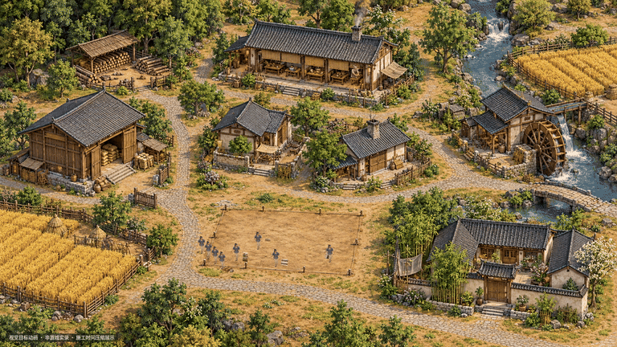

# 山河里：中国风视觉目标样片

20秒，1920×1080，30帧/秒。原创概念动画，施工时间经过压缩；不是游戏实录，也不代表游戏上线验收。当前用于对齐视觉方向，人物与背景的融合仍可继续打磨。

[下载完整 MP4 视频](shanheli-concept-20261019.mp4)

下面是同一段内容的 GIF 预览，可直接查看动作；完整画质请下载 MP4。

展示内容包括木石取放与搬运、多人在建筑不同侧面施工、地基与柱梁墙屋顶逐步成型，以及伐木、收割和室内劳作。完整的磨坊、食堂与军备产业链仍需在游戏中另行实现、实测。

后续实际游戏应沿用同一套原创素材、相机与尺度、角色锚点和动作规范，并以真实游戏运行画面对照验收。
